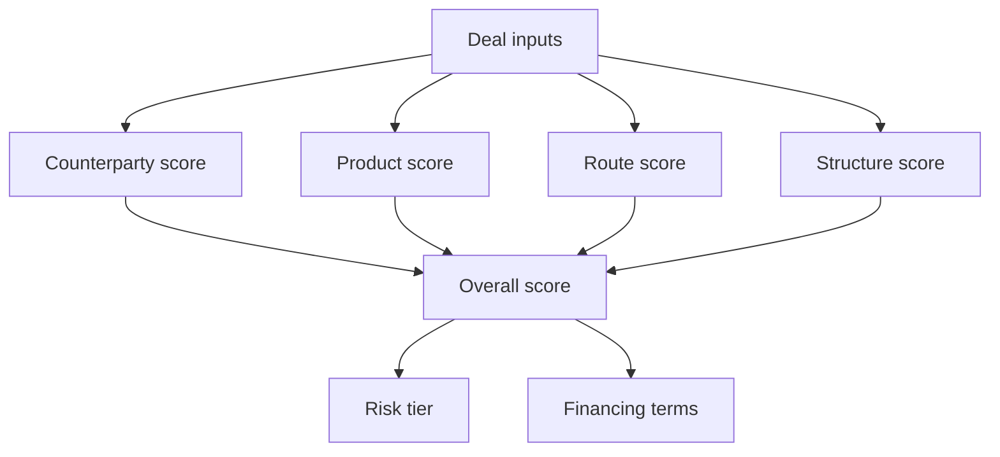

# Risk Calculation

This document describes how credit risk is calculated in the TruMarket credit-risk MVP.

Risk is expressed as a **weighted composite score from 0–100**, where **higher = safer**. The model is **rule-based** (not ML), aligned with the CRAM reference tables (`tm-cram-reference-tables-2026-07.md`).

## Source files

| File | Role |
|------|------|
| `src/lib/scoring.ts` | Main score computation |
| `src/lib/scoring-constants.ts` | Dimension weights |
| `src/lib/cram-scoring.ts` | CRAM transit / flag / customs / transshipment point tables |
| `src/lib/product-risk-tables.ts` | CRAM Table 1 — product perishability inputs |
| `src/lib/route-risk-tables.ts` | CRAM Table 2 — corridor defaults |
| `src/lib/product-market-pair-table.ts` | CRAM Table 3 — product×market flag overrides |
| `src/lib/assessment.ts` | Assessment assembly for the UI |
| `src/lib/risk-factors.ts` | Narrative concerns and mitigating factors |
| `src/lib/financing.ts` | Financing terms derived from the overall score |

## Overview



Each dimension is computed independently, **clamped to 0–100**, then combined.

---

## Overall score equation

```
overallRaw =
  counterparty × 0.35
+ product      × 0.20
+ route        × 0.15
+ structure    × 0.30

overall = round(overallRaw)   // display only
tier    = getTier(overallRaw) // tier & financing use unrounded value
```

Weights are defined in `DIMENSION_WEIGHTS` (`src/lib/scoring-constants.ts`).

| Dimension    | Weight | What it captures |
|--------------|--------|------------------|
| Counterparty | 35%    | Buyer & supplier creditworthiness, platform history, relationship depth, external credit |
| Product      | 20%    | Perishability (CRAM), cold chain, quality grade, EUDR |
| Route        | 15%    | Transit time vs shelf life, corridor risk, transshipments, customs, incoterm |
| Structure    | 30%    | Advance %, collateral, insurance, payment terms, deal history |

---

## 1. Counterparty risk (35%)

Built from buyer and supplier sub-scores, then blended with relationship and external-credit bonuses.

### Buyer score

Sum of four factors, clamped 0–100:

| Factor | Scoring |
|--------|---------|
| Years in business | `null` → **12**; ≤5 → 10; ≤10 → 20; ≤20 → 30; >20 → **40** |
| License valid | `true` → 15; `false` → 0; unknown → 8 |
| Platform completion rate | `null` → **3**; else `min(25, rate × 0.25)` |
| Avg payment delay (days) | `null` → **4**; 0 → 20; ≤5 → 15; ≤15 → 8; else → 0 |

Neutral (`null`) defaults sit between the worst and next-worst confirmed bands so disclosing a bad value always scores worse than leaving unknown.

### Supplier score

Same structure as buyer, with different caps on two factors:

| Factor | Scoring |
|--------|---------|
| Years in business | max **30** (not 40); same `null` → **12** bands as buyer |
| Platform completion rate | `null` → **4**; else `min(30, rate × 0.3)` |
| Quality rejection % | `null` → **5**; 0% → 25; ≤3% → 18; ≤8% → 10; else → 0 |

### Counterparty blend equation

```
counterparty = clamp(
  buyer   × 0.6
+ supplier × 0.4
+ relationshipBonus
+ externalCreditBonus
)
```

**Relationship bonus** (`relationshipAdjustment`):

| Condition | Bonus |
|-----------|-------|
| ≥4 prior deals between parties | +10 |
| ≥1 prior deal | +5 |
| Relationship age > 12 months | +5 |

**External credit bonus** (`externalCreditBonus`) — Coface / buyer rating:

| Condition | Bonus |
|-----------|-------|
| Coface coverage ≥ 80% of deal | +12 |
| Coface coverage ≥ 50% | +8 |
| Any positive Coface coverage % | +5 |
| Coface amount ≥ 80% of deal value (when % missing) | +12 |
| Coface amount ≥ 50% of deal value | +8 |
| Any positive Coface amount | +5 |
| Legacy `externalCreditSignal` or buyer `creditRating` on file | +8 |
| None of the above | 0 |

---

## 2. Product risk (20%) — CRAM dimension B

Product risk uses a **CRAM base of 70** plus perishability and deal-specific adjustments. It does **not** use the display `baseScore` column from the product table directly.

### Product score equation

```
product = clamp(
  70
+ perishabilityPoints
+ coldChainAdj
+ gradeAdj
+ eudrAdj
)
```

**Perishability points** (CRAM Table 1, `PERISHABILITY_POINTS`):

| Perishability class | Points |
|---------------------|--------|
| Non-Perishable | +18 |
| Semi-Perishable | +9 |
| Perishable | −4 |
| Ultra-Perishable | −12 |

Points come from `lookupProductRisk(product).perishabilityPoints`, or default to Perishable (−4) for unknown products.

**Adjustments:**

| Factor | Adjustment |
|--------|------------|
| Cold chain required (and not Non-Perishable) | −8 |
| Grade A / Class I | +8 |
| Grade B / Class II | 0 |
| Industrial (any other grade) | −10 |
| EUDR product → EU destination | −12 |

EUDR applies when the product is flagged `eudrRequired` in the product table **and** the destination matches an EU market (Spain, Portugal, Netherlands, Germany, Rotterdam, Valencia, Lisbon).

### Supported products (CRAM Table 1)

| Product | AC risk group | Perishability | Shelf life (days) | EUDR |
|---------|---------------|---------------|-------------------|------|
| Asparagus | G1 | Ultra-Perishable | 10–21 | No |
| Grapes | G1 | Perishable | 30–60 | No |
| Blueberries | G1 | Perishable | 30–45 | No |
| Avocado | G2 | Perishable | 25–35 | No |
| Mandarin | G3 | Perishable | 30–60 | No |
| Ginger | G3 | Semi-Perishable | 60–120 | No |
| Coffee | G4 | Non-Perishable | 365+ | Yes |
| Cacao | G4 | Non-Perishable | 180–365 | Yes |

Product names are matched after stripping a `Fresh ` prefix (e.g. "Fresh Mandarin" → Mandarin). Unknown products use perishability default −4.

---

## 3. Trade route risk (15%) — CRAM dimensions C + C4

Route risk uses a **CRAM base of 70** plus transit, corridor flag, transshipment, customs, and incoterm adjustments.

### Route score equation

```
route = clamp(
  70
+ cramTransitPoints(perishabilityClass, estimatedTransitDays)
+ cramRouteFlagPoints(corridorFlag)
+ cramTransshipmentPoints(numberOfTransshipments)
+ cramCustomsPoints(customsClearanceDaysMax)
+ incotermAdjustment(incoterm)
)
```

### Resolving the corridor flag (C4)

Before scoring, the corridor flag is resolved in this order (`resolveRouteRiskFlag`):

1. **Product×market pair override** — CRAM Table 3 (`product-market-pair-table.ts`) if commodity group + product + destination match a row
2. **Corridor default** — from CRAM Table 2 (`route-risk-tables.ts`) for the origin→destination pair
3. **35-day rule** — if product is Ultra-/Perishable/Semi-Perishable **and** transit > 35 days → flag floors at **High**

Examples of pair overrides:

| Product | Market | Override flag | Rationale |
|---------|--------|---------------|-----------|
| Mandarin | Colombia | Medium | Short transit but thin market depth |
| Blueberries / Grapes | Israel | High | Long transit, thin resale on rejection |
| Coffee / Cacao | EU | Low (+ EUDR gate) | Physically low-risk; EUDR compliance required |
| Any fresh G1–G3 | Egypt / Jordan | High | Long transshipped transit + customs variability |

### CRAM point tables (`cram-scoring.ts`)

**Transit points** — depend on perishability class:

| Class | Transit ≤14d / ≤21d / ≤30d / ≤60d / >60d |
|-------|------------------------------------------|
| Non-Perishable | — / — / +12 / 0 / −8 |
| Fresh (all other classes) | +14 / +6 / −10 / −10 / −10 |

**Corridor flag points:**

| Flag | Points |
|------|--------|
| Low | +12 |
| Low-Med | +8 |
| Medium | +3 |
| Med-High | −5 |
| High | −15 |

**Transshipments:**

| Count | Points |
|-------|--------|
| 0 | +10 |
| 1 | 0 |
| 2+ | −15 |

**Customs clearance (max days):**

| Days | Points |
|------|--------|
| `null` (unknown) | 0 |
| ≤3 | +5 |
| 4–7 | 0 |
| >7 | −8 |

**Incoterm** (risk allocation — more seller obligation → higher score):

| Incoterm | Adjustment |
|----------|------------|
| EXW | −5 |
| FCA, FAS | 0 |
| FOB | +5 |
| CFR, CPT | +3 |
| CIF, CIP | +8 |
| DAP, DPU, DDP | +10 |

### Supported corridors (CRAM Table 2)

| Route | Transit (days) | Default flag |
|-------|----------------|--------------|
| Peru → Colombia | 4 | Low-Med |
| Peru → USA (East) | 13 | Low |
| Peru → USA (West) | 14 | Low |
| Peru → Spain | 19 | Low |
| Peru → Portugal | 20 | Low |
| Peru → Netherlands | 21 | Low |
| Peru → Israel | 36 | High |
| Peru → Egypt | 28 | Med-High |
| Peru → Jordan | 33 | Med-High |
| Peru → Thailand | 34 | Medium |
| Peru → Taiwan | 30 | Medium |
| Peru → China | 25 | Medium |
| Peru → UAE | 31 | Medium |
| Unknown route | — | Medium (default flag), score base 55 for display |

Routes are matched by country (last segment of origin/destination) or exact corridor key.

---

## 4. Transaction structure risk (30%)

Implements the Kanato Foley CRAM **Transaction Structure** model (calibration 2026-07-11). Source: `src/lib/transaction-structure/`.

### Composite

```
structure = Sub-A × 50% + Sub-D × 50%
```

Sub-B (collateral & security) is computed for reference but weighted **0%**.

### Cash-flow engine

Four signed events drive exposure duration and downside resilience:

```
Supplier Advance : −supAdvPct × purchaseTotal  @ supAdvDay
Supplier Final   : −supFinPct × purchaseTotal  @ supFinDay
Buyer First      : +buyFirstPct × saleTotal    @ buyFirstDay
Buyer Final      : +buyFinalPct × saleTotal    @ buyFinalDay
```

```
Exposure Duration = buyFinalDay − supAdvDay
Best Case Margin  = cum4
Worst Case Margin = cum3 + BuyerFinal × (1 − severity)   [severity = 100%]
```

### Sub-A — Payment terms & cash flow (50% of structure)

```
Sub-A = PaymentTermsPts × 60%
      + AdvancePts      × 10%    [clamp(advancePaymentPct, 0, 100)]
      + ContractTypePts × 15%    [Spot=100, Forward=60, Seasonal=40]
      + DealPurposePts  × 15%    [Export=100, Retail=80, Processing=60, Resale=40]
```

**Payment terms buckets** (floor match on exposure duration):

| Min days | Points |
|----------|--------|
| 0 | 100 |
| 30 | 80 |
| 35 | 60 |
| 45 | 40 |
| 60 | 20 |
| 91 | 0 |

### Sub-D — Downside resilience (50% of structure)

If worst-case margin ≥ 0 → **100 pts** (no downside).

Otherwise `Sub-D = bucket(Upside:Downside ratio)` where ratio = bestCaseMargin / |worstCaseMargin|.

### Structure tiers

| Tier | Min score | Protocol |
|------|-----------|----------|
| Strong | 80 | Standard terms, fast-track routing |
| Adequate | 60 | Policy-minimum collateral/advance |
| Weak | 40 | Additional collateral/insurance required |
| Insufficient | 0 | Restructure or escalate |

### Required inputs (many not on a single contract)

| Field | Notes |
|-------|-------|
| `purchaseTotalUSD`, `saleTotalUSD` | Often split across purchase + sale docs |
| `supAdvDay/Pct`, `supFinDay/Pct` | Supplier payment schedule |
| `buyFirstDay/Pct`, `buyFinalDay/Pct` | Buyer payment schedule |
| `dealPurpose` | Export / Retail / Processing / Resale |
| `tmProductOwnership`, `collectionRights` | TM title & CISG collection rights |

Buyer tranches may be partially inferred from `paymentTerms` text. **Purchase total** is extracted from purchase orders / supplier contracts when detected; if two documents carry different totals, the lower maps to purchase and the higher to sale. Supplier payment schedule still typically requires user confirmation.

**Defaults (not prompted):** buyer & supplier licenses assumed valid; TM product ownership and CISG collection rights assumed `true`.

### Worked examples (seed deals)

| Deal | Sub-A | Sub-D | Composite | Tier |
|------|-------|-------|-----------|------|
| TM-2026-014 Mandarin | 78 | 30 | **54** | Weak |
| TM-2026-015 Blueberries | 66 | 100 | **83** | Strong |

If structure fields are incomplete, structure scores **50** (neutral) until the user confirms missing inputs.

---

## Risk tier

Mapped from the overall score via `getTier()`:

| Overall score | Tier |
|---------------|------|
| ≥ 75 | Low Risk |
| 60–74 | Medium-Low Risk |
| 45–59 | Medium-High Risk |
| < 45 | High Risk |

---

## Narrative risk factors

Beyond the numeric score, `analyzeRiskFactors()` in `src/lib/risk-factors.ts` generates up to **5 concerns** and **5 mitigating factors** for the dashboard.

**Example concerns:** first-time platform relationship, unconfirmed licenses, ultra-perishable shelf life, cold chain dependency, extended payment terms, no advance/collateral, high corridor risk (35-day rule or Med-High/High flag).

**Example mitigating factors:** Coface coverage on file, Grade A quality, direct route with no transshipment, prior deals between parties, FOB incoterm, strong advance payment %.

---

## Financing recommendations

`recommendFinancingTerms()` in `src/lib/financing.ts` maps the overall score to commercial terms.

**Base interest rate:** 6.0%. **Final rate** = base rate + risk premium.

### Max financing & advance

| Overall score | Max financing % | Required advance % | Risk premium | Decision |
|---------------|-----------------|--------------------|--------------|----------|
| ≥ 80 | 100% | 0%* | +0.5% | AUTO-APPROVE |
| 70–79 | 80% | 0%* | +1.5% | AUTO-APPROVE |
| 60–69 | 70% | 10% | +2.5% | MANUAL REVIEW |
| 50–59 | 50% | 20% | +4.0% | SENIOR APPROVAL |
| < 50 | 0% | 30% | +6.0% | RECOMMEND REJECT |

\*Required advance is 0% when overall ≥ 75; 10% when ≥ 65; 20% when ≥ 55; else 30%.

### Collateral guidance

| Overall score | Collateral required |
|---------------|---------------------|
| ≥ 80 | None |
| 70–79 | Optional (reduces rate by 0.5%) |
| 60–69 | Warehouse receipt OR buyer guarantee |
| 50–59 | Inventory pledge + insurance |
| < 50 | Full collateral (>100% deal value) |

### Approval routing

| Overall score | Approval level |
|---------------|----------------|
| ≥ 75 | Automated |
| 60–74 | Credit Manager |
| 45–59 | Credit Director |
| < 45 | Executive Override Only |

---

## Creating a new deal assessment

Users can start a **New deal assessment** from the home screen:

1. Upload trade documents (PDF) — fields auto-fill via `pdf-parse` extraction
2. Enter **Coface coverage %** and/or **coverage amount (USD)**, or upload a Coface PDF
3. Confirm product (CRAM Table 1), route (CRAM Table 2), parties, and deal value
4. Continue through document ingestion → risk dashboard → financing recommendation

Document analysis runs via Vite dev middleware locally and Vercel serverless handlers (`api/analyze-documents`, `api/analyze-coface`) in production.

---

## Missing data handling

When counterparty fields are `null` or unknown, the model assigns **neutral default scores** rather than failing the assessment. This keeps the MVP usable with partial document extraction.

| Field | Default when undisclosed |
|-------|--------------------------|
| Buyer / supplier license | Valid (full license points) |
| TM product ownership | `true` |
| CISG collection rights | `true` |
| Purchase total | Extracted from uploaded purchase order when possible; otherwise prompted |

---

## Summary

```
overall = 0.35 × counterparty + 0.20 × product + 0.15 × route + 0.30 × structure

counterparty = clamp(0.6×buyer + 0.4×supplier + relationship + externalCredit)
product      = clamp(70 + perishabilityPts + coldChain + grade + eudr)
route        = clamp(70 + transit + flag + transship + customs + incoterm)
structure    = Sub-A × 50% + Sub-D × 50%   (CRAM Transaction Structure model)
```

Counterparty and deal structure are weighted most heavily (35% + 30%). Product and route scores follow the CRAM reference tables with a neutral base of 70, not fixed per-row lookup scores.
