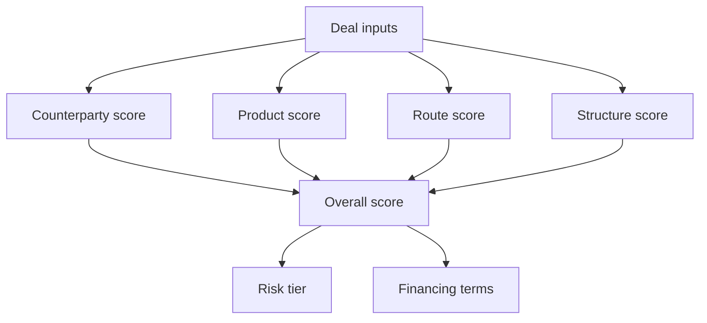

# Risk Calculation

This document describes how credit risk is calculated in the TruMarket credit-risk MVP.

Risk is expressed as a **weighted composite score from 0–100**, where **higher = safer**. The logic lives in:

- `src/lib/scoring.ts` — score computation
- `src/lib/scoring-constants.ts` — dimension weights
- `src/lib/assessment.ts` — assessment assembly for the UI
- `src/lib/risk-factors.ts` — narrative concerns and mitigating factors
- `src/lib/financing.ts` — financing terms derived from the overall score

## Overview



### Overall score formula

```
overall = counterparty × 0.35 + product × 0.20 + route × 0.15 + structure × 0.30
```

Each dimension is clamped to 0–100 before weighting.

### Dimension weights

| Dimension    | Weight | Description |
|--------------|--------|-------------|
| Counterparty | 35%    | Buyer & supplier creditworthiness, platform history, relationship depth |
| Product      | 20%    | Perishability, cold chain, quality grade |
| Route        | 15%    | Transit time, transshipments, incoterms, geographic risk |
| Structure    | 30%    | Payment terms, advance, collateral, insurance |

---

## 1. Counterparty risk (35%)

Built from buyer and supplier sub-scores, then blended.

### Buyer score

| Factor | Scoring |
|--------|---------|
| Years in business | `null` → 15; ≤5 → 10; ≤10 → 20; ≤20 → 30; >20 → 40 |
| License valid | `true` → 15; `false` → 0; unknown → 8 |
| Platform completion rate | `null` → 15; else `min(25, rate × 0.25)` |
| Avg payment delay (days) | `null` → 15; 0 → 20; ≤5 → 15; ≤15 → 8; else → 0 |

### Supplier score

Same structure as buyer, with different caps:

| Factor | Scoring |
|--------|---------|
| Years in business | max 30 instead of 40 |
| Platform completion rate | `min(30, rate × 0.3)` |
| Quality rejection % | `null` → 13; 0% → 25; ≤3% → 18; ≤8% → 10; else → 0 |

### Counterparty blend

```
counterparty = buyer × 0.6 + supplier × 0.4 + relationship bonus + external credit bonus
```

**Relationship bonus:**

- +5 if ≥1 prior deal between parties
- +10 if ≥4 prior deals
- +5 if relationship age > 12 months

**External credit bonus:**

- +8 if `externalCreditSignal` or buyer `creditRating` is present (e.g. Coface)

---

## 2. Product risk (20%)

Product risk uses a **lookup table** by commodity (`src/lib/product-risk-tables.ts`). Base scores are then adjusted for cold chain and quality grade.

### Product base score table

| Product | Base score | Perishability |
|---------|------------|---------------|
| Dried Fruit | 90 | Non-Perishable |
| Frozen Berries | 85 | Non-Perishable |
| Mandarin | 72 | Semi-Perishable |
| Avocado | 65 | Perishable |
| Grapes | 60 | Perishable |
| Mango | 55 | Perishable |
| Blueberries | 48 | Perishable |
| Asparagus | 40 | Ultra-Perishable |
| Strawberries | 35 | Ultra-Perishable |
| Unknown product | 50 | (default) |

Product names are matched after stripping a `Fresh ` prefix (e.g. "Fresh Mandarin" → Mandarin).

**Adjustments (applied on top of table base):**

- Cold chain required: **−8**
- Grade A / Class I: **+8**
- Grade B / Class II: **0**
- Industrial: **−10**

---

## 3. Trade route risk (15%)

Route risk uses a **lookup table** by origin → destination (`src/lib/route-risk-tables.ts`), with fallbacks for unlisted corridors.

### Route base score table

| Route | Base score | Transit (days) | Risk flag |
|-------|------------|----------------|-----------|
| Peru → Colombia | 88 | 7 | Low |
| Mexico → USA | 82 | 5 | Low |
| Chile → USA | 75 | 14 | Low |
| South Africa → UK | 58 | 16 | Medium |
| Peru → UAE | 50 | 18 | Medium |
| Peru → Netherlands | 45 | 22 | Medium |
| Peru → Taiwan | 42 | 35 | Medium |
| Unknown route | 55 | (default) | — |

Routes are matched by country (last segment of origin/destination) or exact corridor key.

### Adjustments (on top of table base)

**Transshipments:**

- 0 → +10
- 1 → 0
- 2+ → −15

**Route risk flag:**

- Low → 0
- Medium → −10
- High → −25

**Incoterm** (risk allocation — more seller obligation → higher score):

| Incoterm | Adjustment |
|----------|------------|
| EXW | −5 |
| FCA, FAS | 0 |
| FOB | +5 |
| CFR, CPT | +3 |
| CIF, CIP | +8 |
| DAP, DPU, DDP | +10 |

---

## 4. Transaction structure risk (30%)

### Base score (advance payment %)

| Advance % | Base score |
|-----------|------------|
| 0% | 20 |
| 1–19% | 35 |
| 20–39% | 55 |
| 40–59% | 75 |
| 60%+ | 90 |

### Collateral bonus

| Collateral type | Bonus |
|-----------------|-------|
| None | 0 |
| Personal Guarantee | +5 |
| Warehouse Receipt | +10 |
| Inventory Pledge | +10 |
| Bank Guarantee | +15 |
| Letter of Credit | +15 |

### Insurance bonus

| Coverage | Bonus |
|----------|-------|
| None | 0 |
| Basic | +5 |
| Comprehensive | +10 |
| All Risk | +15 |

### Payment terms adjustment

| Terms | Adjustment |
|-------|------------|
| Cash in advance / prepaid | +15 |
| Letter of credit | +12 |
| Against B/L or documents | +8 |
| 30 days | +5 |
| 60 days | 0 |
| 90 days | −12 |
| 120 days | −20 |

### Structure relationship adjustment

- ≥5 prior deals between parties: **+7**
- ≥1 prior deal: **+5**
- No prior deals: **−8**

---

## Risk tier

Mapped from the overall score via `getTier()`:

| Overall score | Tier |
|---------------|------|
| ≥ 75 | Low Risk |
| 60–74 | Medium-Low Risk |
| 45–59 | Medium-High Risk |
| < 45 | High Risk |

---

## Narrative risk factors

Beyond the numeric score, `analyzeRiskFactors()` in `src/lib/risk-factors.ts` generates up to **5 concerns** and **5 mitigating factors** for the dashboard. Examples:

**Concerns:** no advance payment, no collateral, extended payment terms, ultra-perishable shelf life, unconfirmed licenses

**Mitigating:** Coface credit insurance, Grade A quality, direct short-haul route, prior deals between parties, FOB incoterm

---

## Financing recommendations

`recommendFinancingTerms()` in `src/lib/financing.ts` maps the overall score to commercial terms:

| Overall score | Max financing | Required advance | Risk premium | Decision |
|---------------|---------------|------------------|--------------|----------|
| ≥ 80 | 100% | 0% | +0.5% | AUTO-APPROVE |
| 70–79 | 80% | 0% | +1.5% | AUTO-APPROVE |
| 60–69 | 70% | 10% | +2.5% | MANUAL REVIEW |
| 50–59 | 50% | 20% | +4.0% | SENIOR APPROVAL |
| < 50 | 0% | 30% | +6.0% | RECOMMEND REJECT |

Base interest rate: **6.0%**. Final rate = base rate + risk premium.

Approval levels: Automated (≥75), Credit Manager (60–74), Credit Director (45–59), Executive Override Only (<45).

**External credit bonus** (Coface):

- Coverage ≥ 80% of deal (or amount ≥ 80% of value): **+12**
- Coverage ≥ 50%: **+8**
- Any positive coverage: **+5**
- Legacy Coface signal / credit rating on file: **+8**

---

## Creating a new deal assessment

Users can start a **New deal assessment** from the home screen:

1. Upload deal documentation (PDF, Word, Excel, image)
2. Enter **Coface coverage %** and/or **coverage amount (USD)**, or upload a Coface document
3. Confirm product (from product table), route (from route table), parties, and deal value
4. Continue through document ingestion → risk dashboard → financing recommendation

---

## Missing data handling

When counterparty fields are `null` or unknown, the model assigns **neutral default scores** rather than failing the assessment. This keeps the MVP usable with partial document extraction.

---

## Summary

Risk is **not** a machine-learning model in this MVP. It is a **rule-based scorecard** across four trade-finance dimensions, with counterparty and deal structure weighted most heavily (35% + 30%).
